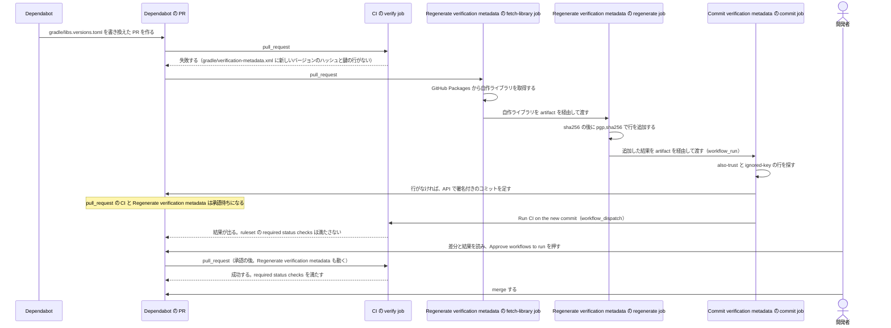

# android-supply-chain-lab

このリポジトリは、Gradle がビルドに取り込むコードのサプライチェーンリスクを減らす構成と運用手順を、Android アプリで検証したものである。対象は、Gradle wrapper、plugin を含む依存、自作ライブラリの配布である。

## 目次

1. [想定するリスクと経路](#1-想定するリスクと経路)
2. [構成](#2-構成)
3. [構成を選んだ理由](#3-構成を選んだ理由)
4. [作業ごとの手順](#4-作業ごとの手順)
5. [確認できていないこと](#5-確認できていないこと)
6. [このリポジトリについて](#6-このリポジトリについて)

## 1. 想定するリスクと経路

このリポジトリで検証した構成が想定するリスクは、経路ごとに次のとおりである。

| 経路 | 想定するリスク |
| --- | --- |
| Gradle wrapper | 改ざんされた `gradle-wrapper.jar` や Gradle の配布物が、ビルドの最初に実行される |
| プラグインとライブラリの取得 | 公開リポジトリの成果物が差し替えられ、差し替えられたものがビルドに入る |
| 依存のバージョンの解決 | 意図しないバージョンが使われる。ビルドの時期でバージョンが変わる |
| 自作ライブラリの配布 | 自作ライブラリのリポジトリの write role を 1 人分不正に取得した攻撃者が、正規のリリースの手順を通さずに、成果物を公開する |

この構成は、次のことを前提にする。

- 依存と GitHub Actions の自動更新に Dependabot を使う
- 依存に SNAPSHOT バージョンを指定しない。Gradle は SNAPSHOT バージョンの依存を検証しない（[公式](https://docs.gradle.org/9.7.1/userguide/dependency_verification.html#sub:verification-metadata)）

## 2. 構成

### Dependabot の PR から merge までの流れ

Dependabot が依存のバージョンをアップデートする PR を作ると、merge までに次の workflow と job が動く。

| workflow | job | `permissions` | 役目 |
| --- | --- | --- | --- |
| `CI` | `verify` | `contents: read`、`packages: read` | `gradle/verification-metadata.xml` で依存を検証しながら `./gradlew build` を実行する |
| `Regenerate verification metadata` | `fetch-library` | `contents: read`、`packages: read` | PR のコードを実行せずに、GitHub Packages から自作ライブラリを取得し、artifact を経由して `regenerate` job に渡す |
| `Regenerate verification metadata` | `regenerate` | `contents: read` | `--write-verification-metadata` を付けて Gradle を実行し、`gradle/verification-metadata.xml` にハッシュと鍵の行を追加し、`gradle.lockfile` を新しいバージョンに書き換える。依存のコードはこの job で初めて動く |
| `Commit verification metadata` | `commit` | `actions: write`、`contents: write` | `workflow_run` で発火し、`regenerate` job が追加した結果を検査して、API で署名付きのコミットを PR に足す。PR のコードは checkout も実行もしない。コミットを足したときは、最後の step の `Run CI on the new commit` が `workflow_dispatch` で `CI` を実行する |



Dependabot が `okio` のバージョンをアップデートする PR を作った場合を例にする。

1. Dependabot が `gradle/libs.versions.toml` を書き換えた PR を作る。`gradle/verification-metadata.xml` には新しいバージョンの `okio` のハッシュと鍵の行がないので、`CI` の `verify` job は検証で失敗する
2. `Regenerate verification metadata` の `regenerate` job が、`permissions` に `contents: write` を持たないまま、次の 2 つのコマンドを順に実行する。Gradle の公式の方法である（3.1）

   ```sh
   ./gradlew -PlibRepositoryDirectory="file://$RUNNER_TEMP/library-repository" \
     --write-verification-metadata sha256 --write-locks build
   ./gradlew -PlibRepositoryDirectory="file://$RUNNER_TEMP/library-repository" \
     --write-verification-metadata pgp,sha256 --export-keys build
   ```

   1 回目のコマンドは、`gradle/verification-metadata.xml` に全成果物の `sha256` のハッシュの行を追加し、`--write-locks` で `gradle.lockfile` を書き換える。2 回目のコマンドは、署名を検証し、署名に使われた鍵を信頼する `trusted-key` の行を `gradle/verification-metadata.xml` に追加する。`--export-keys` は、`trusted-key` の行の鍵を `gradle/verification-keyring.keys` に書き出す
3. `Commit verification metadata` の `commit` job が、PR のコードを実行せずに結果を検査する。`<also-trust` か `<ignored-key` の行があれば止まる。なければ API で署名付きのコミットを PR に足し、`Run CI on the new commit` の step で `CI` を `workflow_dispatch` で実行する。`workflow_dispatch` で動いた `verify` job は、Approve の前に検証の結果を確かめるためのもので、required status checks を満たさない。実験では、`workflow_dispatch` の `verify` job が成功しても、Approve の前は merge できない判定（`mergeStateStatus` が `BLOCKED`）のままで、Approve の後の `pull_request` の実行で `CLEAN` になった（[実験の記録の「ruleset の下での判定」](docs/adr/0002-dependency-verification.md#ruleset-の下での判定)）
4. 開発者が `commit` job のコミットの差分を読み、手動で Approve workflows to run を押して `pull_request` の `verify` job を通し、merge する

`also-trust` と `ignored-key` は、`gradle/verification-metadata.xml` の要素である。`also-trust` は、同じ成果物に別のハッシュも認める。公式は、成果物が正しいことを確かめてから `also-trust` を足すように書いている。

> In general, you should verify the artifact is correct, then declare the additional checksums using also-trust

（[Gradle 9.7.1 の Verifying Dependencies の「Trusting Multiple Checksums」](https://docs.gradle.org/9.7.1/userguide/dependency_verification.html#sec:trusting-several-checksums)）

`ignored-key` は、指定した鍵を検証に使わないようにする。

> Once a key is ignored, it will not be used for verification even if the signature file mentions it.

（[Gradle 9.7.1 の Verifying Dependencies の「Ignoring Unavailable Keys」](https://docs.gradle.org/9.7.1/userguide/dependency_verification.html#ignoring_unavailable_keys)）

`commit` job が止める行は、次の 3 つの検証の失敗から書かれる（3.4）。

- ダウンロードした成果物から計算したハッシュが、`gradle/verification-metadata.xml` に書かれたハッシュと合わない
- 成果物の署名ファイル（`.asc`）の署名が、成果物の中身と合わない
- 署名に使われた鍵を、鍵サーバーから取得できない

`--write-verification-metadata` を付けない通常の `build` は、3 つの場合とも検証のエラーで終わる（[実験の記録の「5. 失敗の確認」](docs/adr/0002-dependency-verification.md#5-失敗の確認)）。`--write-verification-metadata` を付けた Gradle は、エラーで終わらない。ハッシュが合わない成果物には `also-trust` の行を追加し、署名が合わない成果物と取得できない鍵には `ignored-key` の行を追加する（[gradle/gradle#35403](https://github.com/gradle/gradle/issues/35403)、open）。`regenerate` job では、行を追加した後の `build`（`Verify in the same environment` の step）も成功し、`commit` job に進む。実験では、3 つの場合とも `commit` job が `also-trust` か `ignored-key` の行を見つけて止まった（[実験の記録の「main の定義での確認」](docs/adr/0002-dependency-verification.md#main-の定義での確認)）。

### 攻撃経路ごとの対策

[1 章](#1-想定するリスクと経路)の経路ごとに、対策に使う機能とツールは次のとおりである。

| 経路 | 対策に使う機能とツール |
| --- | --- |
| Gradle wrapper | `distributionSha256Sum`、[wrapper validation の Action](https://github.com/gradle/actions/blob/v6.4.1/docs/wrapper-validation.md) |
| プラグインとライブラリの取得 | Gradle の dependency verification（`pgp,sha256`）、`Regenerate verification metadata` と `Commit verification metadata` |
| 依存のバージョンの解決 | `gradle.lockfile`、`failOnNonReproducibleResolution()` |
| 自作ライブラリの配布 | 署名、タグからのリビルドの比較、artifact attestations、GitHub Packages の Maven の依存の `sha256` |

### 機能を 3 つの層に分ける

機能を 3 つの層に分ける。層 1 は標準機能である。層 2 は、Dependabot が `gradle/verification-metadata.xml` を更新しない部分と、`--write-verification-metadata` を付けた Gradle が検証の失敗で止まらない部分を補う実装で、省けない。層 3 は、標準の運用より強くするために足したものである。層 3 には、足す理由と消せる条件を書く。

| 層 | 内容 | 理由 |
| --- | --- | --- |
| 1 標準機能 | Gradle の dependency verification。`gradle/verification-metadata.xml` には、`sha256` の後に `pgp,sha256 --export-keys` を実行して行を追加する。armored の keyring、`<key-servers enabled="false">`、`distributionSha256Sum`、wrapper validation、dependency locking、`failOnNonReproducibleResolution()`、Dependabot の `cooldown` と `groups`、ruleset の required status checks も使う | 公式の手段で足りる。行を追加する方法は、公式の 2 つの方法（`pgp,sha256` を 1 回だけ実行する方法と、`sha256` の後に `pgp,sha256` を実行する方法）のうち、強いほうを選んだ。理由と代償は 3.1 に書く |
| 2 足りない部分を補う実装 | `sha256` の後に `pgp,sha256` を実行する方法を Dependabot の PR で動かす `Regenerate verification metadata` と `Commit verification metadata`、`commit` job の `<also-trust\|<ignored-key` の検査 | Dependabot は `gradle/verification-metadata.xml` を更新しない（[dependabot-core#1996](https://github.com/dependabot/dependabot-core/issues/1996)、open）。`--write-verification-metadata` を付けた Gradle は、検証の失敗でも止まらない（[gradle/gradle#35403](https://github.com/gradle/gradle/issues/35403)、open） |
| 3 あえて足すもの | 下の表 | 標準の運用より強くしたい点がある |

層 3 で足したものは次のとおりである。

| 足したもの | 足す理由 | 消せる条件 |
| --- | --- | --- |
| 行を追加する workflow を 2 つの job と `workflow_run` に分ける | 依存のコードと書き込みの token を同じ job に置かない | GitHub App などで、行を追加する作業を、`permissions` に `contents: write` のない場所だけで行える場合 |
| key-server を 2 つに絞る | Gradle の既定の一覧では、鍵の取得が実行ごとに失敗したり成功したりする | Gradle の既定の一覧で鍵を安定して取得できるようになった場合 |
| `trusted-artifacts` に `gradle:gradle`、`*-sources.jar`、`*-javadoc.jar` を入れる | `gradle:gradle` がないと、Android Studio の sync が検証で止まった。sources と javadoc は、取得を再現すると検証で失敗した。Android Studio では確認していない | Android Studio がこれらを取得しなくなった場合 |
| `verify` job で `setup-gradle`（`cache-provider: basic`）を使う | 一般のプロジェクトはキャッシュを使うので、キャッシュありで成り立つ構成にする（[実験の記録の「CI のキャッシュ」](docs/adr/0001-gradle-wrapper-verification.md#ci-のキャッシュ)）。キャッシュの中の依存も検証される | 時間が問題にならない場合 |
| `androidx.*` を `cooldown` の対象から外す | Google Maven の公開日が取れず、安定したバージョンの更新が止まる | Dependabot が Google Maven の公開日を取れるようになった場合 |
| ライブラリのタグからリビルドして比較し、artifact attestations を付ける | 公開した成果物がタグのソースから作れることを確認する | 配布元が他の手段で provenance を出す場合 |

### やめたもの

| やめたもの | 理由 |
| --- | --- |
| `pgp,sha256` を 1 回だけ実行し、足りない POM の行を開発者が手動で足す運用 | `sha256` の後に `pgp,sha256` を実行すれば、手作業が要らない。`pgp,sha256` を 1 回だけ実行する構成では、同じ鍵で署名された別のファイルへの差し替えを止められなかった（3.1） |
| 自作のスクリプト（`review_verification_metadata.py`、`pin_library_hashes.py`） | `sha256` の後に `pgp,sha256` を実行すると、全成果物がハッシュを持つ。既存のバージョンの差し替えを止める判定は `commit` job の検査 1 つで足りる |
| 自作のバージョンの検査（`checkResolvedVersions`） | `gradle.lockfile` で足りる（[実験の記録の「自前の検査（廃止）」](docs/adr/0003-version-resolution.md#自前の検査廃止)） |
| `pull_request_target` で行を追加する | 書き込みの token とシークレットで PR のコードを実行することになる |

### 受け入れるリスク

| リスク | 受け入れる理由 |
| --- | --- |
| 取得できる別の鍵で署名された新しいバージョンは、自動で信頼されて `commit` job の検査を通る | 期待する fingerprint を機械で照合する方法（以前の `LIBRARY_SIGNING_KEYS`）は、無署名の新しいバージョンを塞げないので戻さない。`cooldown` と、開発者が差分の `trusted-key` を読むことで補う（3.2） |
| 無署名の新しいバージョンは、最初に取得したときのハッシュをそのまま信頼して通る | `cooldown` と、開発者が `reason="Artifact is not signed"` の行を読むことで補う（3.2） |
| 正規の鍵で署名された悪意のある新しいバージョンは通る | 自作ライブラリについて、android-supply-chain-lab-lib の実験の記録の脅威の表は、「署名鍵と公開のワークフローの侵害。最初から不正なバージョンを公開」を「防げない」としている（3.2） |
| 配布元が侵害されていれば、`--write-verification-metadata` は侵害された成果物を記録する | 公式も、`--write-verification-metadata` は今のリポジトリの中身を信頼するだけだと書いている（[`#sec:bootstrapping-verification`](https://docs.gradle.org/9.7.1/userguide/dependency_verification.html#sec:bootstrapping-verification)） |
| group の単位で鍵を信頼すると、鍵が盗まれたときに同じ group の新しい成果物も通る | `--write-verification-metadata` がまとめる範囲をそのまま使う。`commit` job のコミットの差分にある、範囲の広い `regex="true"` の行は、開発者が読む |
| default branch のキャッシュを信頼する | キャッシュから復元した Gradle の配布物は、`distributionSha256Sum` で再検証されない（[実験の記録の「CI のキャッシュ」](docs/adr/0001-gradle-wrapper-verification.md#ci-のキャッシュ)） |
| Google Maven の成果物は、同じバージョンのまま差し替えられる可能性がある | Google Maven が同じバージョンの差し替えを禁じるかどうかの公式の方針が見つからなかった。既存のバージョンの差し替えはハッシュで止まる |

## 3. 構成を選んだ理由

### 3.1 `sha256` の後に `pgp,sha256` を実行する理由

項目ごとではなく、構成全体で比較した。重く見たのは、止めるべきものが止まるかどうかと、更新のたびに開発者が手動で行う作業である。

ここでの「同じ鍵での差し替え」は、既存のバージョンのファイルが、同じ鍵で署名された別のファイル（古いバージョンのファイルなど）に差し替えられることを指す。依存のバージョンを下げる PR のことではない。

| 構成 | ハッシュを持つ成果物 | 同じ鍵での差し替え | 開発者が手動で行う作業 |
| --- | --- | --- | --- |
| ハッシュだけ（`sha256`） | すべて | 止まる見込み。既存のハッシュからの推論で、試していない | ない。ただし全成果物で最初に取得したときのハッシュをそのまま信頼し、公開者の鍵による確認がない |
| `pgp,sha256` を 1 回だけ実行する | 無署名の成果物だけ | 止まらない | 足りない親 POM と BOM の行を足す |
| `pgp,sha256` を 1 回だけ実行し、自作のスクリプトを足す（以前の構成） | 無署名の成果物と自作ライブラリ | 自作ライブラリでは止まる。他の依存では止まらない | 足りない親 POM と BOM の行を足す |
| `sha256` の後に `pgp,sha256` を実行する（公式の方法、採用） | すべて | 止まる | ない |

`pgp,sha256` を 1 回だけ実行すると、親 POM や BOM の行が足りず、その後の `verify` job が検証で失敗することがある。Gradle は、同じファイルを別のリポジトリの経路で見つけたときに 1 つしか記録しないが、検証はリポジトリごとに行うからである（[実験の記録の「2 回の再生成が必要な原因」](docs/adr/0002-dependency-verification.md#2-回の再生成が必要な原因)）。以前の構成では、この失敗を見て開発者が手動で行を足していた。さらに、自作ライブラリの差し替えを止めるために、`sha256` を自作のスクリプトで足していた。`sha256` の後に `pgp,sha256` を実行すれば、`sha256` の実行が全成果物の行を書くので、どちらも要らない。

`sha256` の後に `pgp,sha256` を実行する方法を選んだ理由は次のとおりである。

- 公式の手順である。公式は、完全性も検証したいなら、チェックサムで行を追加してから、署名で行を追加し直すように書いている（[`#sec:bootstrapping-signature-verification`](https://docs.gradle.org/9.7.1/userguide/dependency_verification.html#sec:bootstrapping-signature-verification)）
- 全成果物がハッシュを持つので、既存のバージョンの差し替えは `also-trust` として書かれ、`commit` job の検査で止まる
- 足りない POM の行を、開発者が手動で足さなくてよい
- 自作のスクリプトが要らなくなる

代償は次のとおりである。

- `commit` job のコミットの差分が大きくなる。このリポジトリでは、Android Gradle plugin の更新の差分が +749 行になった（[実験の記録の「main の定義での確認」](docs/adr/0002-dependency-verification.md#main-の定義での確認)）。行の大半はハッシュで、開発者は 4.2 のキーワードで読む
- 行を追加する時間は約 2 倍になる

ハッシュだけの構成は、全成果物について最初に取得したときのハッシュをそのまま信頼し、公開者の鍵による確認がなくなるので選ばなかった。

### 3.2 `pgp` で止まるものと止まらないもの

署名は、ファイルの中身とある鍵を結び付けるだけである。公式も、署名の検証で分かるのは特定の鍵で署名されたことだけで、署名した人が正当かどうかは分からないと書いている（[`#sec:bootstrapping-verification`](https://docs.gradle.org/9.7.1/userguide/dependency_verification.html#sec:bootstrapping-verification)）。

次の場合は、署名の検証では止まらない。

| 場合 | 結果 |
| --- | --- |
| 同じ鍵での差し替え | 署名だけなら通る。`sha256` の後に `pgp,sha256` を実行していれば、ハッシュで止まる |
| 鍵サーバーから取得できる別の鍵で署名された新しいバージョン | `trusted-key` が自動で足され、`commit` job の検査も `build` も通る |
| 無署名の新しいバージョン | 最初に取得したときのハッシュをそのまま信頼して通る |

前の 2 つは、手元の検証用のリポジトリと鍵サーバーで確認した（[実験の記録の「grep の判定」](docs/adr/0002-dependency-verification.md#grep-の判定)）。

鍵の名前は、鍵を作る人が任意に付けられる。

> Anyone can put an arbitrary name when generating a PGP key.

（[Gradle 9.7.1 の Verifying Dependencies の「Adding Global Keys」の「Security Considerations」](https://docs.gradle.org/9.7.1/userguide/dependency_verification.html#security_considerations)）

信頼の根拠は、`gradle/verification-metadata.xml` に書かれた鍵の fingerprint である（[実験の記録の「1. 生成の方式」](docs/adr/0002-dependency-verification.md#1-生成の方式)）。`--write-verification-metadata` を付けて実行するときは、Gradle は `<key-servers enabled="false">` を無視し、足りない鍵を鍵サーバーから取得する（[`#sec:local-keyring-only`](https://docs.gradle.org/9.7.1/userguide/dependency_verification.html#sec:local-keyring-only)）。

取得できる別の鍵で署名された新しいバージョンと、無署名の新しいバージョンは、`commit` job の検査を通るので、開発者の確認と `cooldown` に任せる（[実験の記録の「Consequences」](docs/adr/0002-dependency-verification.md#consequences)）。開発者の確認では、差分の新しい `trusted-key` と keyring の行、`reason="Artifact is not signed"` の行を読む。

正規の鍵で署名された悪意のあるリリースについて、android-supply-chain-lab-lib の[実験の記録](https://github.com/appachan/android-supply-chain-lab-lib/blob/main/docs/adr/0001-private-library-distribution.md)の「1. sha256 の追記の自動化」の脅威の表は、「署名鍵と公開のワークフローの侵害。最初から不正なバージョンを公開」を「防げない」「ソースのレビューの問題である」としている。

期待する fingerprint を機械で照合する案（以前の `LIBRARY_SIGNING_KEYS`）は戻さない。無署名の新しいバージョンが同じように通るので、止めきれないからである。この判断に公式の根拠はない。

### 3.3 公式の更新手順と違う点

公式の [`#sec:verification-update`](https://docs.gradle.org/9.7.1/userguide/dependency_verification.html#sec:verification-update) は、`--write-verification-metadata` で行を追加した後に、次の 3 つの作業を求めている。この運用では、3 つとも行わない。

| 公式の手順 | この運用 | 理由 |
| --- | --- | --- |
| `Generated by Gradle` の全行を確認する | 行わない。開発者はキーワードで読む | `sha256` の後に `pgp,sha256` を実行すると、更新のたびに数百行のハッシュが増えることがある。全行を確認する運用は続かない。ハッシュの役割は、次の変更を検知することにある |
| `origin` を `Verified` に書き換える | 行わない | `commit` job のコミットは workflow が作る。開発者が手動で編集したコミットを Dependabot のブランチに入れると、Dependabot が PR を作り直せなくなる |
| 古い行を毎回消す | 必要なときに開発者が手動で消す（4.6） | 消すと差分が大きくなり、開発者が読むべき行を見つけにくくなる |

### 3.4 `commit` job の検査で止める行

`commit` job は、`regenerate` job が行を追加した `gradle/verification-metadata.xml` の全体に `<also-trust` か `<ignored-key` があれば止まる。この判定に公式の根拠はない。`--write-verification-metadata` を付けた Gradle は、検証に失敗しても止まらず、失敗を受け入れる行を書いて続ける（[gradle/gradle#35403](https://github.com/gradle/gradle/issues/35403)、open）。止めるオプションもない。

Gradle が書く行（[`WriteDependencyVerificationFile`](https://github.com/gradle/gradle/blob/v9.7.1/platforms/software/dependency-management/src/main/java/org/gradle/api/internal/artifacts/ivyservice/ivyresolve/verification/writer/WriteDependencyVerificationFile.java#L343-L369)）と `commit` job の検査の結果は次のとおりである。

| 状況 | 書かれる行 | `commit` job の検査 |
| --- | --- | --- |
| 鍵を取得できない | `<configuration>` に `<ignored-key ... reason="Key couldn't be downloaded from any key server"/>` | 止まる |
| 署名と中身が一致しない | artifact に `<ignored-key ... reason="PGP verification failed"/>` | 止まる |
| 既存のハッシュと違う | `<also-trust value="..."/>` | 止まる |
| `.asc` がない | `reason="Artifact is not signed"` のハッシュ | 通る（最初に取得したときのハッシュを信頼する） |
| `.asc` が読めない、署名がない | `reason="PGP signature verification failed!"` のハッシュ（ソースからの読み取り） | 通る |

壊れた `.asc` を止めないのは、`.asc` を消しても同じ結果になるからである。この判断にも公式の根拠はない。

上の表で「止まる」とした 3 つの状況は、このリポジトリの一時の PR で、`commit` job がコミットせずに失敗することを確認した（[実験の記録の「main の定義での確認」](docs/adr/0002-dependency-verification.md#main-の定義での確認)）。

`ignored-key` を残すしかない依存が出たら、変更行だけを見る形に変える。ファイル全体を見る検査は、既存の行で毎回止まるからである。`git diff --no-index ... | grep -qE` の形は、`pipefail` があると新しい行があっても止まらない。`git diff --no-index` は差分があると 1 を返し、ファイルがないときも 1 を返すので、2 つを区別できない。Actions の既定のシェル（`bash -e {0}`）と `shell: bash`（`bash --noprofile --norc -eo pipefail {0}`）の両方で正しく動く形は次のとおりである（手元の bash でだけ確認した）。

```sh
status=0
diff -u "$RUNNER_TEMP/current/gradle/verification-metadata.xml" \
  "$RUNNER_TEMP/regenerated/gradle/verification-metadata.xml" > "$RUNNER_TEMP/metadata.diff" || status=$?
if [ "$status" -gt 1 ]; then exit "$status"; fi
if grep -qE '^\+.*<(also-trust|ignored-key)' "$RUNNER_TEMP/metadata.diff"; then
  echo "::error::Regeneration accepted an artifact that failed verification"
  exit 1
fi
```

### 3.5 空の `GRADLE_USER_HOME` を使う場面

| 場面 | 環境 | 理由 |
| --- | --- | --- |
| 初めて導入するとき | 空の `GRADLE_USER_HOME` | キャッシュがあると、親 POM や BOM の行が欠けることがある。欠けたままで、空の `GRADLE_USER_HOME` の `build` が通るかを、まだ確認できていない（5 章） |
| Dependabot の PR で `regenerate` job が行を追加するとき | Actions の runner | `setup-gradle` は PR では読み取りだけで、catalog が変わる更新ではキャッシュも復元されない。`regenerate` job の `GRADLE_USER_HOME` は、実質的に空になる |
| 開発者が手動で依存を追加するとき | 普段の環境でよい | `gradle/verification-metadata.xml` から欠ける親 POM は、署名で検証されるか、無署名なら行が書かれた（4.3） |
| `verify` job | main のキャッシュ | キャッシュの中の依存も検証される（[実験の記録の「キャッシュの中の改ざん」](docs/adr/0001-gradle-wrapper-verification.md#キャッシュの中の改ざん)） |

空の `GRADLE_USER_HOME` で依存を取得すると、Maven Central に負荷をかける。Sonatype は、429 を避けるために、取得済みの成果物を空の環境や使い捨ての環境から繰り返しダウンロードしないよう勧めている（[公式の FAQ](https://central.sonatype.org/faq/429-error/#why-am-i-seeing-a-429)）。このリポジトリでも、空の `GRADLE_USER_HOME` の `build` を繰り返した後に、Maven Central が一部のファイルに 429 を返した。手元では、空の `GRADLE_USER_HOME` を初めて導入するときだけに使う。

### 3.6 鍵サーバーを 2 つに絞る理由

Gradle は鍵ごとに key-server の順番をランダムに並べ替え、5 秒の範囲でだけ再試行する（[`PublicKeyDownloadService`](https://github.com/gradle/gradle/blob/v9.7.1/platforms/software/security/src/main/java/org/gradle/security/internal/PublicKeyDownloadService.java#L61-L76)）。既定の一覧（[`DefaultKeyServers`](https://github.com/gradle/gradle/blob/v9.7.1/platforms/software/dependency-management/src/main/java/org/gradle/api/internal/artifacts/ivyservice/ivyresolve/verification/DefaultKeyServers.java)）に応答しないサーバーがあると、取得できる鍵でも 5 秒を過ぎると Gradle は取得をやめ、`ignored-key` を書くと考えている。ただし因果は機構からの推測で、試行数は少ない。追加の費用はないので、key-server を 2 つに絞った。このリポジトリと実際のアプリの両方で、2 つに絞ると `ignored-key` が出なくなった（[実験の記録の「鍵サーバー」](docs/adr/0002-dependency-verification.md#鍵サーバー)）。

`verify` job は `<key-servers enabled="false">` なので鍵サーバーを使わない。keyring に鍵がなければ `verify` job が失敗するので、鍵がないことに気付ける。

### 3.7 依存のコードを実行する job と `contents: write` を持つ job を分ける方法

| 方法 | 判断 | 理由 |
| --- | --- | --- |
| 開発者が手元で行を追加して push する | 不採用 | Dependabot の PR ごとに、開発者が手元で行を追加して push する作業が要る。検証されていない新しいプラグインを開発者の環境で実行する |
| `pull_request` の 1 つの job で、行を追加して push する | 不採用 | 依存のコードと書き込みの token が同じ job に入る |
| `pull_request_target` で PR を checkout する | 不採用 | 書き込みの token とシークレットで PR のコードを実行する |
| `permissions` に `contents: write` のない job で行を追加し、`workflow_run` の job でコミットする | 採用 | 書き込みの token のある job では PR のコードが動かない |
| GitHub App の token でコミットする | 保留 | Approve workflows to run の操作を避けられるが、シークレットが増える |

同じ job の中で step を分けるだけでは、依存のコードが token を読める（android-supply-chain-lab-lib の[実験の記録](https://github.com/appachan/android-supply-chain-lab-lib/blob/main/docs/adr/0001-private-library-distribution.md)の「2. token を渡さない再生成」）。GitHub Packages の Maven の依存は、`fetch-library` job で取得し、成果物を artifact で `regenerate` job に渡す。

### 3.8 lockfile の役割

目的は、意図しないバージョンが使われないことと、ビルドの時期でバージョンが変わらないことである。Gradle の dependency locking と `failOnNonReproducibleResolution()` で目的を満たせるかを、先に確認した。`gradle.lockfile` は subproject の `*CompileClasspath` と `*RuntimeClasspath` に使う。残りの configuration と plugin の classpath には、`failOnNonReproducibleResolution()` を使う。2 つは同じ configuration では併用できない（[実験の記録の「Decision」](docs/adr/0003-version-resolution.md#decision)）。

信頼する鍵で署名された成果物は、`sha256` の後に `pgp,sha256` を実行しても、バージョンが変わると `gradle/verification-metadata.xml` に行が増える。ただし推移的依存のバージョンの変化を一覧で読むには、lockfile の差分のほうが向いている。

### 3.9 `cooldown` から `androidx.*` を外す理由

`cooldown` を設定しなくても、Dependabot は version update に既定で 3 日の `cooldown` を適用する（[公式](https://docs.github.com/en/code-security/reference/supply-chain-security/dependabot-options-reference)）。Google Maven の依存では、Dependabot は最新の 1 バージョンの公開日しか取れなかった。最新が pre-release だと、安定したバージョンの更新が止まった。そのため `androidx.*` を対象から外した。代償として、androidx は公開直後のバージョンも提案される。`androidx.*` に一致しない Google Maven のライブラリには、同じ問題が残る。

### 3.10 配布元ごとの違い

| 配布元 | 同じバージョンの差し替え | 運用 |
| --- | --- | --- |
| Maven Central | できない（[公式](https://central.sonatype.org/faq/can-i-change-a-component/)） | 署名とハッシュで検証する |
| Google Maven | 公式の方針は見つからなかった | 署名とハッシュで検証する。受け入れるリスクとして扱う |
| GitHub Packages の Maven の依存 | 削除すれば、同じバージョンを別の中身で出し直せた（android-supply-chain-lab-lib の[実験の記録](https://github.com/appachan/android-supply-chain-lab-lib/blob/main/docs/adr/0001-private-library-distribution.md)） | 署名とハッシュに加え、開発者が手動で `.aar` の値を配布元の job summary と照合し、`gh attestation verify` を使う |

### 3.11 他のプロジェクトの運用

GitHub のコード検索で、bot の PR で `--write-verification-metadata` を実行するプロジェクトを調べた（2026-11-02 時点）。

| プロジェクト | bot | 実行のきっかけ | 方式 | `verify-signatures` | `ignored-key` |
| --- | --- | --- | --- | --- | --- |
| [apache/airflow](https://github.com/apache/airflow)（java-sdk） | Dependabot | committer の `workflow_dispatch` | `sha256` | false | 0 |
| [TNG/keycloak-mock](https://github.com/TNG/keycloak-mock) | Dependabot | PR で自動。`--refresh-dependencies` を付ける | `sha256` | false | 0 |
| [Adyen/adyen-android](https://github.com/Adyen/adyen-android) | Renovate | `renovate/**` への push。`--refresh-dependencies` を付ける。ビルドの job に bot の token を渡さない | `sha256` | false | 0 |
| [dhis2/dhis2-android-capture-app](https://github.com/dhis2/dhis2-android-capture-app) | - | PR の変更 | `sha256` | false | 26 |
| [rundeck/rundeck-cli](https://github.com/rundeck/rundeck-cli) | Renovate | `renovate/**` への push | `pgp,sha256` | true | 16 |
| `appachan/android-supply-chain-lab` | Dependabot | PR で自動。`workflow_run` でコミット | `sha256` の後に `pgp,sha256` | true | 0 |

- 署名を使うのは rundeck-cli だけだった。残りの 4 件は `sha256` だけを使う
- Adyen は、BOM と親 POM が module の metadata のキャッシュにあると記録されないので `--refresh-dependencies` が要る、とコメントに書いている。このリポジトリでは、初めて導入するときに空の `GRADLE_USER_HOME` を使う。`--refresh-dependencies` で代わりになるかは確認していない
- `also-trust` は 5 件とも 0 件だった

### 3.12 wrapper を 2 つの方法で検証する理由

`distributionSha256Sum` は配布物をダウンロードしたときだけ検証し、wrapper validation は `gradle-wrapper.jar` だけを検証する。対象が違うので両方使う。CI のキャッシュから復元された配布物は、`distributionSha256Sum` で再検証されない。キャッシュの配布物は default branch の実行で検証されたものだという前提で、再検証されないことを受け入れる（[実験の記録の「CI のキャッシュ」](docs/adr/0001-gradle-wrapper-verification.md#ci-のキャッシュ)）。

## 4. 作業ごとの手順

### 4.1 初めて導入するとき

`gradle/verification-metadata.xml` のない状態から始める。

1. dependency locking を入れる。root の `build.gradle.kts` に次を足す。`settings.gradle.kts` と included build の build script には、`failOnNonReproducibleResolution()` を足す。`gradle.lockfile` と `failOnNonReproducibleResolution()` を使い分ける理由は 3.8 に書いた

   ```kotlin
   subprojects {
       buildscript.configurations.configureEach { resolutionStrategy.failOnNonReproducibleResolution() }
       configurations.configureEach {
           if (name.endsWith("CompileClasspath", ignoreCase = true) || name.endsWith("RuntimeClasspath", ignoreCase = true)) {
               resolutionStrategy.activateDependencyLocking()
           } else {
               resolutionStrategy.failOnNonReproducibleResolution()
           }
       }
   }
   ```

2. `gradle/verification-metadata.xml` の骨組みを書く。`verify-signatures` は `false` のままでよい。手順 4 の `pgp,sha256` が `true` に書き換える（[`WriteDependencyVerificationFile`](https://github.com/gradle/gradle/blob/v9.7.1/platforms/software/dependency-management/src/main/java/org/gradle/api/internal/artifacts/ivyservice/ivyresolve/verification/writer/WriteDependencyVerificationFile.java#L231-L233)）

   ```xml
   <?xml version="1.0" encoding="UTF-8"?>
   <verification-metadata xmlns="https://schema.gradle.org/dependency-verification" xmlns:xsi="http://www.w3.org/2001/XMLSchema-instance" xsi:schemaLocation="https://schema.gradle.org/dependency-verification https://schema.gradle.org/dependency-verification/dependency-verification-1.4.xsd">
      <configuration>
         <verify-metadata>true</verify-metadata>
         <verify-signatures>false</verify-signatures>
         <keyring-format>armored</keyring-format>
         <key-servers enabled="false">
            <key-server uri="https://keyserver.ubuntu.com"/>
            <key-server uri="https://keys.openpgp.org"/>
         </key-servers>
      </configuration>
   </verification-metadata>
   ```

   Android Studio を使うなら、`<trusted-artifacts>` に sources、javadoc、`gradle:gradle` を足す。`gradle:gradle` がないと、Android Studio の sync が検証で止まった（[実験の記録の「Android Studio の sync と gradle:gradle」](docs/adr/0002-dependency-verification.md#android-studio-の-sync-と-gradlegradle)）。sources と javadoc は、取得を再現すると検証で失敗した。Android Studio では確認していない（[実験の記録の「2. 網羅性」](docs/adr/0002-dependency-verification.md#2-網羅性)）。`keyring-format` を先に書かないと、バイナリの `.gpg` も作られる

3. 空の `GRADLE_USER_HOME` で `sha256` を実行し、結果を残す

   ```sh
   WORK_DIR="$(mktemp -d)"
   export GRADLE_USER_HOME="$WORK_DIR/gradle-user-home"
   ./gradlew --write-verification-metadata sha256 --write-locks build
   cp gradle/verification-metadata.xml "$WORK_DIR/stage1.xml"
   ```

   キャッシュのある `GRADLE_USER_HOME` で `gradle/verification-metadata.xml` を作ると、親 POM や BOM の行の一部は書かれないことがある。欠けた POM は署名で検証されるので、空の `GRADLE_USER_HOME` の `build` も通る見込みである。ただし、まだ確認できていない（5 章）。そのため、初めて導入するときは空の `GRADLE_USER_HOME` で作る

4. 同じ `GRADLE_USER_HOME` で `pgp,sha256` を実行する

   ```sh
   ./gradlew --write-verification-metadata pgp,sha256 --export-keys build
   ```

5. `grep -cE '<also-trust|<ignored-key' gradle/verification-metadata.xml` が 0 であることを確認する。`ignored-key` があれば、`gradle/verification-metadata.xml` を手順 3 で残した `$WORK_DIR/stage1.xml` の内容に戻して、`pgp,sha256` の実行をやり直す。`--refresh-keys` を付けても既存の `ignored-key` は残るので、戻す必要がある

   ```sh
   cp "$WORK_DIR/stage1.xml" gradle/verification-metadata.xml
   ./gradlew --write-verification-metadata pgp,sha256 --export-keys --refresh-keys build
   ```

6. 別の空の `GRADLE_USER_HOME` で、検証付きの `build` を実行する

   ```sh
   GRADLE_USER_HOME="$(mktemp -d)" ./gradlew build
   ```

7. 差分を読んで commit する。読むときの目安は 4.2 のキーワードと同じである

`build` に含まれないタスク（`connectedAndroidTest`、スクリーンショットの記録など）が解決する依存は、この手順では記録されないことがある。公式も、タスクの実行中にだけ解決される依存は自動では見つからないと書いている（[`#sec:verification-update`](https://docs.gradle.org/9.7.1/userguide/dependency_verification.html#sec:verification-update)）。CI で使うタスクの依存が足りなければ、そのタスクを `build` の後ろに足して行を追加する。`connectedAndroidTest` は、`build` で行を追加した `gradle/verification-metadata.xml` のまま、空の `GRADLE_USER_HOME` で成功することを確認した（[実験の記録の「検証の範囲」](docs/adr/0003-version-resolution.md#検証の範囲)）。

Robolectric のように Gradle の外で成果物を取得するものは、この検証の対象にならない。

この手順を実際のアプリに適用した結果は、[実験の記録の「初回のセットアップ」](docs/adr/0002-dependency-verification.md#appachanrss-reader-の初回のセットアップ)にある。

### 4.2 Dependabot の PR を merge するまで

`dependabot.yml` は次のように設定する。

- `package-ecosystem: gradle` は `groups` で 1 つの PR にまとめる。すべての更新が同じ `gradle/verification-metadata.xml` を変えるので、PR を分けると 1 つを merge したときに残りがコンフリクトする
- `cooldown` は `default-days: 7` にし、`androidx.*` を `exclude` に入れる（3.9）
- `package-ecosystem: github-actions` にも同じ `cooldown` を設定する

`Regenerate verification metadata` と `Commit verification metadata` は、次の 3 つをすべて満たす PR だけで動く。

- PR の作成者が Dependabot（`dependabot[bot]`）である
- PR のブランチが同じリポジトリにある。fork の PR ではない
- ブランチ名が `dependabot/gradle/` で始まる

Dependabot のブランチ名の既定は `dependabot/PACKAGE-MANAGER/DEPENDENCY` である（[公式](https://docs.github.com/en/code-security/reference/supply-chain-security/dependabot-options-reference#pull-request-branch-name--)）。GitHub Actions の更新の PR（`dependabot/github_actions/...`）と fork の PR は、2 つの workflow の対象にならない。GitHub Actions の更新の PR には `commit` job のコミットがないので、`CI` は承認なしで動く（[実験の記録の「Approve workflows to run が必要になる条件」](docs/adr/0002-dependency-verification.md#approve-workflows-to-run-が必要になる条件)）。fork の PR で依存を変えるときは、PR を出す開発者が 4.3 の手順で `gradle/verification-metadata.xml` に行を追加する。

2 つの workflow が動くかどうかは、ブランチ名で決まる。`dependabot.yml` の `pull-request-branch-name`（`separator`、`prefix` など）を変えるときは、2 つの workflow の `if` も直す。

開発者は、次の順に作業する。

1. `Regenerate verification metadata` と `Commit verification metadata` の結果を見る。`commit` job が検査で止まったら merge しない（下の「止まったときの対応」）
2. `commit` job のコミットの差分を読む。読み方は開発者に任せる。目安になるキーワードは次のとおりである
   - `trusted-key`: 新しい鍵である。fingerprint を配布元の公式情報と照合する。鍵の名前は鍵を作る人が任意に付けられるので、確認するのは fingerprint である
   - `trusting`、`regex="true"`: 信頼する group の範囲が広がる
   - `reason="Artifact is not signed"`: 署名のない成果物である。最初に取得したときのハッシュをそのまま信頼する
   - keyring の `uid`: 鍵の持ち主が自分で名乗った名前である。認証された情報ではない
3. `commit` job のコミットがあると、`pull_request` の `CI` と `Regenerate verification metadata` は承認待ちで作られる（[GitHub の公式](https://docs.github.com/en/actions/concepts/security/github_token)）。Approve workflows to run を押して両方を実行する。`CI` と `Regenerate verification metadata` の片方だけを Approve すると、`mergeStateStatus` が `UNSTABLE` のままになる。`Run CI on the new commit` が `workflow_dispatch` で実行した `verify` job は、required status checks を満たさないので、Approve は省けない（[実験の記録の「ruleset の下での判定」](docs/adr/0002-dependency-verification.md#ruleset-の下での判定)）
4. `pull_request` の `verify` job の成功と、`mergeStateStatus` が `CLEAN` であることを確認して merge する

新しい鍵や `trusted-key` の行は、意味が同じでも、実行ごとに書き方の変わることがある。変わるのは、`regex="true"` でまとめられる group と、keyring の `uid` である。開発者が差分で見るのは、`trusted-key` の行にある鍵の fingerprint と、対象の group である。書き方が変わる理由は、実験の記録の「[追記の結果が実行ごとに変わる理由](docs/adr/0002-dependency-verification.md#追記の結果が実行ごとに変わる理由)」に書いた。

Dependabot のブランチには開発者が手動でコミットしない。`[dependabot skip]` のないコミットがあると、Dependabot が rebase を断るためである。`commit` job のコミットには `[dependabot skip]` を付けているので、Dependabot は `commit` job のコミットを上書きして PR を作り直せる（[公式](https://docs.github.com/en/code-security/dependabot/working-with-dependabot/managing-pull-requests-for-dependency-updates)）。

PR を main に追従させるときは、`@dependabot recreate` をコメントする。Dependabot が PR を作り直すと `commit` job のコミットはなくなるので、行を追加する作業と承認をやり直す。このリポジトリでは、`@dependabot rebase` と `@dependabot recreate` が 1 回目のコメントに反応しないことがあった（[実験の記録の「古い PR の扱い」](docs/adr/0002-dependency-verification.md#古い-pr-の扱い)）。反応がなければ、同じコメントをもう一度書く。

`commit` job が止まったときは、次のように対応する。

| 止まった行 | よくある原因 | 対応 |
| --- | --- | --- |
| `<ignored-key ... reason="Key couldn't be downloaded from any key server"/>` | 鍵サーバーの一時的な失敗、または鍵が公開されていない | 鍵サーバーで鍵を探し、fingerprint を配布元の公式情報と照合する。取得できるなら、下のとおり `Regenerate verification metadata` を再実行する。見つからないなら、配布元の公開鍵を keyring に足す PR を先に main に merge する |
| `<ignored-key ... reason="PGP verification failed"/>` | 署名と中身が一致しない | merge しない。成果物の差し替えか、リポジトリの間の差を疑う（[`#failed_signature_verification`](https://docs.gradle.org/9.7.1/userguide/dependency_verification.html#failed_signature_verification)） |
| `<also-trust` | 既存のハッシュと違う中身が配られた | merge しない。同じバージョンの差し替えを疑う |

新しい鍵が要る更新では、鍵サーバーの失敗で `ignored-key` が書かれ、`commit` job の検査で止まることがある。そのときは `Regenerate verification metadata` を再実行する。止まったのは `commit` job の検査だが、`Commit verification metadata` は Gradle を実行しないので、再実行しても鍵の取得はやり直されない。再実行で足りる理由は次のとおりである。

- Gradle は鍵の取得の失敗を 24 時間記録する（[`#sec:refreshing-missing-keys`](https://docs.gradle.org/9.7.1/userguide/dependency_verification.html#sec:refreshing-missing-keys)）。この記録は `GRADLE_USER_HOME` に残る
- Actions の runner は実行ごとに新しい。PR の実行ではキャッシュを保存しない。`setup-gradle` は default branch 以外では読み取り専用が既定である（[実験の記録の「前提の条件」](docs/adr/0001-gradle-wrapper-verification.md#前提の条件)の `cache-read-only`）。そのため、前の実行の失敗の記録は次の実行に残らない
- 鍵サーバーに問い合わせる順番は、実行のたびにランダムで決まる（[`PublicKeyDownloadService`](https://github.com/gradle/gradle/blob/v9.7.1/platforms/software/security/src/main/java/org/gradle/security/internal/PublicKeyDownloadService.java#L61)）

鍵サーバーが長く応答しないなら、時間をおいて再実行する。再実行で足りるという判断は、上の 3 つの項目の仕組みから導いたものである。Actions で鍵サーバーの失敗が起きて再実行した例は、まだない。

Gradle や wrapper の更新を含む PR は、merge の前に Android Studio で sync する。Gradle の更新で鍵や取得するソースが変わると、CI は成功して sync だけが失敗することがある（[実験の記録の「Groovy の鍵」](docs/adr/0002-dependency-verification.md#groovy-の鍵)）。

### 4.3 開発者が手動で依存を追加するとき

各 module の `gradle.lockfile` と異なるバージョンが解決されると、ビルドが失敗する。依存を変えたときは、次の手順で `gradle/verification-metadata.xml` と `gradle.lockfile` を一緒に更新する。

1. 依存を `gradle/libs.versions.toml` と build script に足す。この時点では、`gradle/verification-metadata.xml` に新しい依存の行がないので、Android Studio の sync が検証で止まる。`This can indicate that a dependency has been compromised` の定型の文言は、未登録の依存でも出る
2. `sha256` の後に `pgp,sha256` を実行して、行を追加する。`sha256` が全成果物のハッシュを書き、`pgp,sha256` が鍵の信頼を足す。`--write-locks` は `sha256` の実行に必要である

   ```sh
   ./gradlew --write-verification-metadata sha256 --write-locks build
   ./gradlew --write-verification-metadata pgp,sha256 --export-keys build
   ```

3. Android Studio の sync が通ることを確認する
4. 差分を読み（4.2 のキーワード）、PR を出す。`--write-verification-metadata` は、鍵の信頼を group の単位にまとめることがある。例えば okhttp を足すと、`com.squareup` 全体を信頼する行が増える。`also-trust` と `ignored-key` は検証の失敗を受け入れた行なので、残さない。開発者が出した PR では `Regenerate verification metadata` は動かない

普段のキャッシュのある `GRADLE_USER_HOME` で行を追加してよい。親 POM が別のビルドでキャッシュに入っていて `gradle/verification-metadata.xml` にないと、その親 POM の行は書かれないことがある（[gradle/gradle#19228](https://github.com/gradle/gradle/issues/19228)、[#20194](https://github.com/gradle/gradle/issues/20194)）。欠けた POM が信頼する鍵で署名されていれば、署名で検証されるので `verify` job は成功する。無署名の親 POM で同じ条件を作ったときは、行は欠けずに書かれ、空の `GRADLE_USER_HOME` の `build` も成功した。根拠は実験の記録の「[人が依存を追加するときの確認](docs/adr/0002-dependency-verification.md#人が依存を追加するときの確認2026-11-02)」にある。

Dependabot の PR で行を追加する `regenerate` job は、Linux の runner で動く。無署名の成果物が OS ごとに分かれていると、Linux で行を追加しても macOS の成果物の行は書かれない。そのときは macOS の `build` が検証で失敗する。macOS で `sha256` の後に `pgp,sha256` を実行して、足りない行を足す PR を出す。署名のある成果物（`aapt2` など）は、行がなくても信頼する鍵の署名で検証される（[実験の記録の「2. 網羅性」](docs/adr/0002-dependency-verification.md#2-網羅性)）。

GitHub Packages の Maven の依存（自作ライブラリ）を解決するときは、Gradle に認証情報を渡す。Gradle のプロパティの名前は `GitHubPackagesUsername` と `GitHubPackagesPassword` である。環境変数で渡すときは、名前の前に `ORG_GRADLE_PROJECT_` を付ける。token には `read:packages` のスコープが要る。渡し方は 6 章の「[ビルド](#ビルド)」に書いた。

`settings.gradle.kts` は、2 つのプロパティを `providers.gradleProperty` で読む。Gradle の `credentials(PasswordCredentials::class)` は使わない。`credentials(PasswordCredentials::class)` を使うと、version catalog の取り込みが認証情報を評価する。認証情報がないと、自作ライブラリを使わないタスクも開始の時点で止まる。Dependabot は、GitHub Packages の認証情報を持たずに Gradle を実行して lockfile を更新する。fork の PR と、token を持たない clone も、認証情報を持たない。`providers.gradleProperty` で読めば、認証情報のない環境でも自作ライブラリを使わないタスクは動く（[実験の記録の「認証情報の受け取り方」](docs/adr/0002-dependency-verification.md#認証情報の受け取り方2026-11-03)）。

`Regenerate verification metadata` の `regenerate` job は token を持たない。`regenerate` job は、取得済みの自作ライブラリのディレクトリを `-PlibRepositoryDirectory` で指定する。`-PlibRepositoryDirectory` を指定すると、Gradle は認証情報を使わない。

### 4.4 署名の鍵が変わったときと漏れたとき

ライブラリの側（配布元）は次のように対応する。

- 新しい鍵で最初のバージョンを出す前に、新しい公開鍵と fingerprint を README と `docs/signing/` に載せる
- 鍵が漏れたら、署名のシークレットを新しい鍵に変え、新しいバージョンを出す。古いバージョンは削除しない。削除すると同じバージョンを別の中身で出し直せるようになり、利用側がその中身を受け取るおそれがある

利用側は次のように対応する。

| 場面 | 手順 |
| --- | --- |
| 配布元の鍵の交代 | 配布元の公式情報で新しい fingerprint を確認し、Dependabot の PR の `trusted-key` の行と照合する。Dependabot の PR より先に、新しい公開鍵を keyring に足す PR を main に merge してもよい |
| 配布元の鍵の漏えい | `trusted-key` を消し、同じ fingerprint を `ignored-key` に足して `reason` に理由を書く。過去のバージョンは、引き続き `sha256` で検証される。`ignored-key` が残るので、`commit` job の検査は以後、`gradle/verification-metadata.xml` に残した `ignored-key` の行で止まる。検査を変更行だけを見る形（3.4）に変えるかを判断する |
| 想定外の鍵 | 取得できる別の鍵で署名された新しいバージョンは、`trusted-key` が自動で追加されて `commit` job の検査を通る（3.2）。差分の `trusted-key` と keyring の `uid` を読む |

Gradle は鍵の失効と期限切れを見ない（android-supply-chain-lab-lib の[実験の記録](https://github.com/appachan/android-supply-chain-lab-lib/blob/main/docs/adr/0001-private-library-distribution.md)の「失効」）。`verify` job は `<key-servers enabled="false">` で鍵サーバーを使わないので、鍵サーバーで鍵を失効させても `verify` job には伝わらない。失効した鍵を検証に反映するには、利用側が `gradle/verification-metadata.xml` を変える。

### 4.5 本番の運用で使う署名鍵をオフラインで作る

android-supply-chain-lab-lib では、この手順を実行していない。android-supply-chain-lab-lib の署名の鍵は検証用で、Actions の environment `release` のシークレットにある。

1. ネットワークにつながない端末で、主鍵（署名と認証だけ）と署名用の副鍵を作る。主鍵の秘密部分は端末の外に出さない
2. 主鍵の秘密部分を除いた鍵（副鍵の秘密部分だけを持つもの）を書き出し、パスフレーズと一緒に environment `release` のシークレットにする。Gradle の signing plugin の `useInMemoryPgpKeys` は、副鍵の鍵 ID を取る 3 引数の形で使う
3. 公開鍵と fingerprint を README と `docs/signing/` に載せ、鍵サーバーにも公開する
4. 主鍵の秘密部分と失効証明書を、オフラインの媒体に 2 か所以上で保管する

利用側は副鍵の fingerprint を信頼する。副鍵の交換は、利用側から見ると鍵の交換と同じになる（android-supply-chain-lab-lib の[実験の記録](https://github.com/appachan/android-supply-chain-lab-lib/blob/main/docs/adr/0001-private-library-distribution.md)の「副鍵」）。利用側は、4.4 の表の「配布元の鍵の交代」と同じ手順で、新しい副鍵の fingerprint を `trusted-key` の行と照合する。

### 4.6 使わなくなった行を消すとき

Gradle は使わなくなった行を消さない（[`#sec:verification-metadata-hygiene`](https://docs.gradle.org/9.7.1/userguide/dependency_verification.html#sec:verification-metadata-hygiene)）。依存を更新すると、古いバージョンの行は残る。

開発者が手動で消すのは、必要になったときだけである。`gradle/verification-metadata.xml` の `<components>` の要素を消して 4.1 の手順 3 から 6 を実行し、Dependabot の PR とは別の PR にする。

## 5. 確認できていないこと

| 項目 | 確認した範囲 | 確認できない理由 |
| --- | --- | --- |
| キャッシュのある環境で作った `gradle/verification-metadata.xml` で、空の `GRADLE_USER_HOME` の `build` が通るか | 署名のある親 POM と BOM の行が欠けた `gradle/verification-metadata.xml` で、空の `GRADLE_USER_HOME` の `build` を 2 回実行した。検証の失敗は出なかったが、Maven Central が 1 つのファイルに 429 を返し、一部のタスクが実行できなかった（[実験の記録の「初回のセットアップ」](docs/adr/0002-dependency-verification.md#appachanrss-reader-の初回のセットアップ)） | Maven Central の 429 が続いた。通れば、初めて導入するときも空の `GRADLE_USER_HOME` は要らなくなる |
| `--refresh-dependencies` で空の `GRADLE_USER_HOME` の代わりになるか | 試していない | 上の項目が通れば、空の `GRADLE_USER_HOME` もこのオプションも要らなくなるので、先に上の項目を確認する |

## 6. このリポジトリについて

### 検証テーマと実験の記録

検証のテーマごとに、判断の経緯と実験の結果を 1 つの文書に記録している。`docs/adr/` の文書は、ADR（Architecture Decision Record）の形式で書いている。

1. 土台と Gradle wrapper の検証: [ADR-0001: Gradle wrapper の検証と CI のキャッシュの実験の記録](docs/adr/0001-gradle-wrapper-verification.md)
2. `verification-metadata.xml` と Dependabot の運用: [ADR-0002: `verification-metadata.xml` と Dependabot の実験の記録](docs/adr/0002-dependency-verification.md)
3. version catalog の指定と推移的依存のバージョンのズレの検知と固定: [ADR-0003: version catalog と解決結果のズレ（lockfile）の実験の記録](docs/adr/0003-version-resolution.md)
4. 自作ライブラリを GitHub Packages の Maven で配布するときの完全性の検証と provenance: [android-supply-chain-lab-lib の ADR-0001: 自作ライブラリの配布、完全性、provenance の実験の記録](https://github.com/appachan/android-supply-chain-lab-lib/blob/main/docs/adr/0001-private-library-distribution.md)

### 検証用のアプリ

Kotlin と Jetpack Compose を使う最小の Android アプリ。依存のバージョンは `gradle/libs.versions.toml` で管理する。

| module | 種類 |
| --- | --- |
| `:app` | アプリ |
| `:feature:greeting` | Android library |
| `:shared:ui` | Android library |
| `:shared:domain` | Kotlin JVM |
| `build-logic` | convention plugin の included build |

モジュールは、実際のアプリと同じ種類の構成を確認するためのもので、中身は最小限にしている。

この README の構成は、次のバージョンで検証した。

| 項目 | バージョン |
| --- | --- |
| Gradle | 9.7.1 |
| Android Gradle plugin | 9.3.3 |
| Kotlin | 2.4.21 |
| JDK | 17 |
| compileSdk / targetSdk / minSdk | 37 / 36 / 29 |

バージョンは [Kotlin の互換性表](https://kotlinlang.org/docs/gradle-configure-project.html) で Fully supported とされる範囲を優先して選んだ。Kotlin 2.4.21 の上限は Gradle 9.7.0、AGP 9.3.1 で、Gradle と AGP はそれぞれ同じ minor の修正バージョンを使う。AGP 9.3.1 は JDK 17 で Lint がクラッシュする問題があり、9.3.2 で修正された。

Kotlin は AGP の built-in Kotlin で使うため `org.jetbrains.kotlin.android` は適用しない。KGP のバージョンは Compose Compiler plugin の依存によって 2.4.21 に解決される。

compileSdk は Compose BOM 2026.09.00 の要求で 37 にしている。

### ビルド

`:shared:ui` は GitHub Packages の `com.github.appachan:android-supply-chain-lab-lib` に依存する。GitHub Packages の Maven は、public のパッケージでも認証を求める。

Gradle は、GitHub Packages の認証情報を Gradle のプロパティ `GitHubPackagesUsername` と `GitHubPackagesPassword` から読む。環境変数で渡すときは、`ORG_GRADLE_PROJECT_GitHubPackagesUsername` と `ORG_GRADLE_PROJECT_GitHubPackagesPassword` に値を入れる（[Gradle の公式](https://docs.gradle.org/9.7.1/userguide/build_environment.html#setting_a_project_property)）。Android Studio の sync にも、同じ認証情報が要る。

password には、`read:packages` のスコープを持つ personal access token (classic) を使う。GitHub Packages は fine-grained の personal access token に対応していない。

> GitHub Packages only supports authentication using a personal access token (classic).

（[GitHub Docs の「About permissions for GitHub Packages」の「About scopes and permissions for package registries」](https://docs.github.com/en/packages/learn-github-packages/about-permissions-for-github-packages#about-scopes-and-permissions-for-package-registries)）

`repo` のスコープは `read:packages` の代わりにならない。

```sh
export ORG_GRADLE_PROJECT_GitHubPackagesUsername=<GitHub のユーザー名>
export ORG_GRADLE_PROJECT_GitHubPackagesPassword=<read:packages のある token>
./gradlew build
```

Actions の CI は、同じ 2 つの環境変数に `github.actor` と `github.token` を渡す。追加のシークレットは要らない。fork の PR の扱いは、実験の記録の「[GitHub Packages の Maven の依存](docs/adr/0002-dependency-verification.md#github-packages-の-maven-の依存)」に書く。

認証情報がなくても、android-supply-chain-lab-lib を使わないタスクは実行できる。android-supply-chain-lab-lib を取得するタスクは、認証情報がないと `Username must not be null!`、認証情報が受け付けられないと `Received status code 401 from server: Unauthorized` で失敗する。
